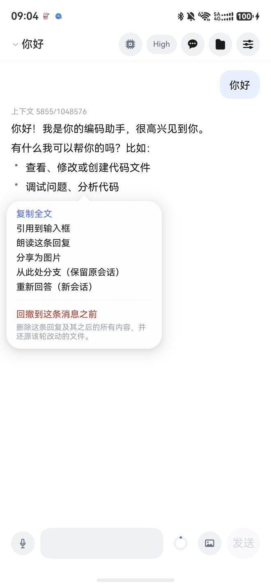
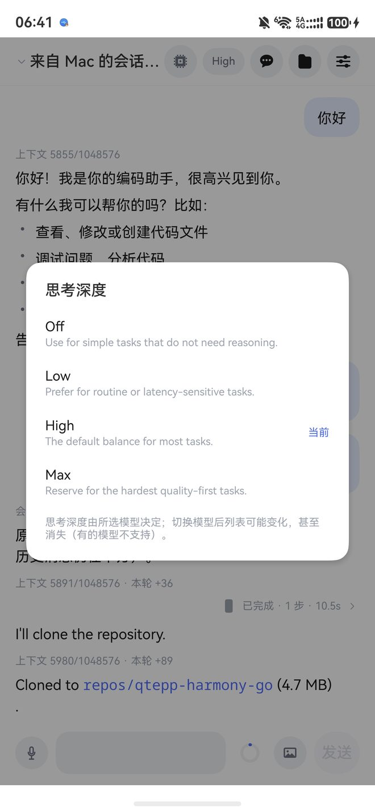
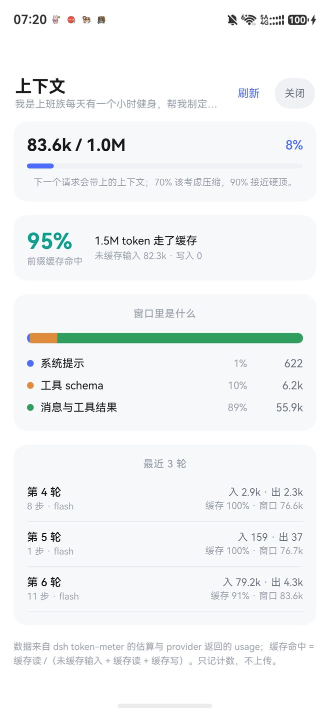
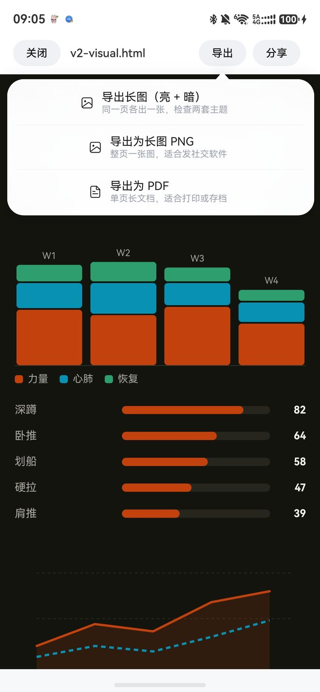
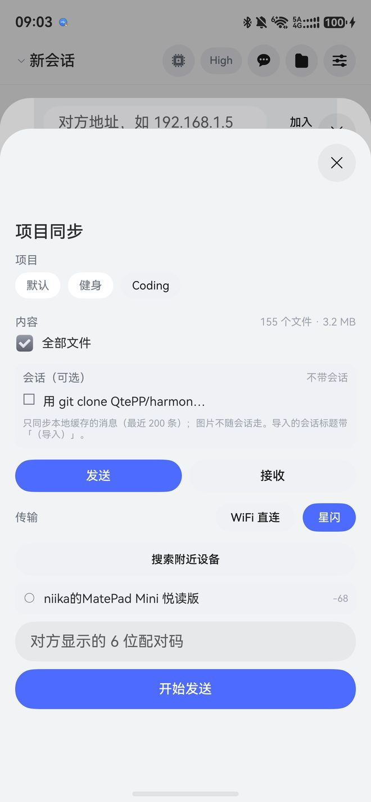
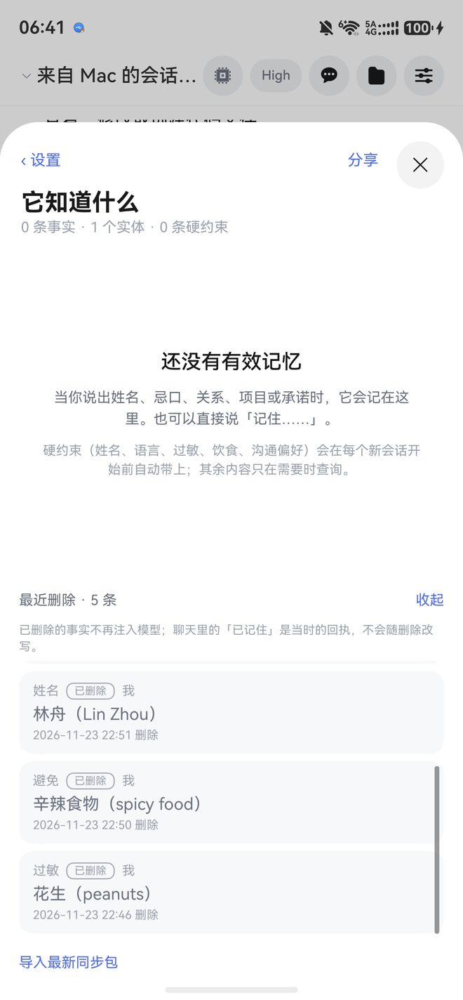
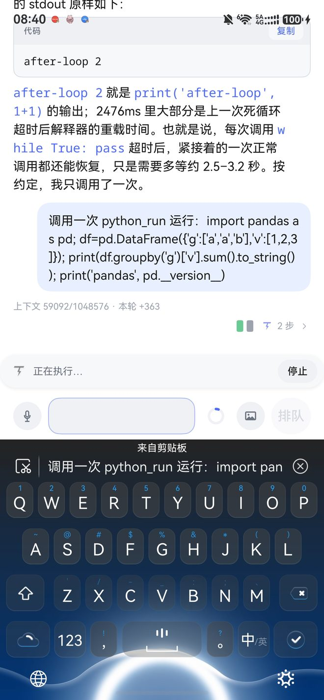
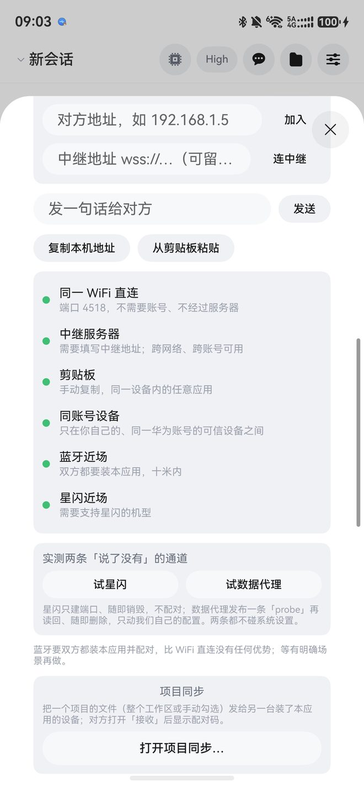

<div align="center">

# HarmonyGo

**在鸿蒙设备上本地运行 DeepSeek Harness 的原生外壳**
**A native shell for running DeepSeek Harness locally on HarmonyOS devices.**

[](LICENSE)
[](https://github.com/QtePP/harmony-go/releases)
[](https://developer.huawei.com/consumer/cn/)
[](https://developer.huawei.com/consumer/cn/arkts/)
[](https://nodejs.org/)

不套壳浏览器、不投屏、不连电脑 —— AI 能力全部运行在手机/平板/2in1 的同一应用进程内。

*No WebView, no screen mirroring, no tethering to a computer — the whole runtime lives inside the app process.*

</div>

---

## 这是什么

> **鸿蒙不是 Personal Agent 的孤岛。**

**HarmonyGo 把完整的 dsh agent 运行时（Node v24.2.0 + 676 个依赖）装进 HarmonyOS 应用进程** —— 手机、平板、2in1 不连电脑就能跑 agent；记忆（端侧本体）、文档（Office / HTML 产物）、**代码（纯 JS git）**、**计算（实验性 Python + 内置 pybot）**、设备间同步（WiFi / 星闪）也都在设备本地完成，不经过云端会话。

仓库：[GitHub](https://github.com/QtePP/harmony-go) · [AtomGit](https://atomgit.com/qtepp/harmony-go)

三件事说清楚它：

- **运行时**：同进程内嵌 Node 与 dsh，用纯 JS 垫片绕开鸿蒙「禁 fork/exec、`--jitless` 无 WASM」的宿主限制 —— 让鸿蒙第一次能原生承载现代 agent 运行时（模型 API 仍联网）。
- **记忆**：端侧 SQLite 个人本体，身份 / 过敏 / 偏好等**硬约束**跨会话自动带上，其余按需查询；可面板查看删除、可导出 bundle、可跨设备合并。
- **协作面与工具**：项目文件、会话缓存、本体 bundle 可经 **WiFi 或星闪** 在两台设备间同步；产物是原生 HTML / Office 文件，可导出长图 / PDF 再分享；另有**纯 JS git**（clone / commit / push）与**实验性 Python**（Pyodide + 内置 pybot）。

内核一句话：**把桌面级 agent 运行时挤进手机沙箱**——不是套壳浏览器，也不是远程调用；因此不用带电脑、不用 Office 订阅、不用把上下文搬到云端。

头号功能是**端侧个人本体（Ontology）**：端侧 SQLite 存身份 / 过敏 / 语言 / 沟通偏好等硬约束，跨会话自动注入，可查看、删除、分享，可导出并对端合并。

> 完整对外口径（SCP 场景-冲突-承诺、能怎么说 / 别怎么说、已验证 / 实验 / 边界状态表）见 [docs/POSITIONING.md](docs/POSITIONING.md)；鸿蒙 PC（2in1）迁移清单见 [docs/POSITIONING.md](docs/POSITIONING.md) §10 与 [docs/ROADMAP.md](docs/ROADMAP.md) §6。

本仓库是 [DeepSeek Harness](https://github.com/deepseek-ai/deepseek-harness)（`dsh`）的**鸿蒙外壳**：

- **原生 ArkUI 界面**，不是 WebView 包壳
- **同进程内嵌 Node v24.2.0**（NAPI `dlopen libnode.so`），不是子进程或远程调用
- **数据全部留在本机**，会话日志、工作区文件都在应用沙箱内
- **三形态自适应**：手机 / 平板 / 2in1（840vp 断点切换单双栏）

`dsh` 是这个仓库唯一的大脑 —— 会话、工具调用、插件、模型适配、持久化全部来自 npm 包 `@deepseek-ai/dsh`。本仓库不含任何 AI 能力，只有**宿主适配层 + 原生界面**。

> 类比：VS Code 与其进程内扩展引擎；或 Electron 之于 Chromium + Node。

<details>
<summary>English</summary>

> **HarmonyOS is not an island for Personal Agents.**

**HarmonyGo embeds a full dsh agent runtime — Node v24.2.0 and its dependency tree — inside a HarmonyOS app process**, so phones, tablets and 2in1 devices run an agent on-device without tethering. Memory (an on-device SQLite ontology), documents (native Office and HTML artifacts), code (pure-JS git), compute (experimental Python and the bundled pybot), and device-to-device sync (Wi-Fi / NearLink) all happen locally rather than through a cloud session.

This repository is the **HarmonyOS shell** for [DeepSeek Harness](https://github.com/deepseek-ai/deepseek-harness) (`dsh`):

- **Native ArkUI interface** — not a WebView wrapper
- **Node v24.2.0 embedded in the same app process** (NAPI `dlopen libnode.so`) — not a subprocess, not a remote call
- **All data stays on the device** — session logs and workspace files live in the app sandbox
- **Three form factors** — phone / tablet / 2in1, switching between single and dual column at the 840vp breakpoint

`dsh` is the only brain here: sessions, tool calls, plugins, model adapters and persistence all come from the npm package `@deepseek-ai/dsh`. This repository contains no AI capability of its own — only the **host adaptation layer + native UI**.

> Analogy: VS Code and its in-process extension engine; or Electron for Chromium + Node.

</details>

## 截图

> 全部来自真机（手机 CMM-AL10），不是模拟器或设计稿；页面为实际渲染结果。

<table>
<tr>
<td width="33%">

**对话与消息操作**（引用 / 朗读 / 分享 / 回撤）



</td>
<td width="33%">

**工具轨迹**：手机上直接 clone 仓库、跑 git



</td>
<td width="33%">

**上下文面板**：窗口占用、缓存命中、组成占比



</td>
</tr>
<tr>
<td width="33%">

**导出**：整页长图 / 单页 PDF / 亮暗双长图



</td>
<td width="33%">

**HTML 产物**：暗色下的组件页面，可拉起分享


</td>
<td width="33%">

**项目同步**：WiFi / 星闪，配对码，文件 + 会话



</td>
</tr>
<tr>
<td width="33%">

**端侧本体**：它知道什么，可查看 / 删除 / 分享



</td>
<td width="33%">

**端侧 Python（实验）**：`python_run` 跑 pandas



</td>
<td width="33%">

**设置**：密钥、GitHub Token、模型、能力开关



</td>
</tr>
</table>

## 功能

「已验证 / 实验 / 未验证」的完整状态见 [docs/POSITIONING.md](docs/POSITIONING.md) §8；标注「实验」的行默认关闭或非产品能力。

| 能力 | 说明 |
|---|---|
| **本地运行时** | Node v24.2.0 内嵌在应用进程，无外部依赖 |
| **流式对话** | 思考过程、工具调用、回答实时呈现 |
| **工具轨迹** | 每次调用按功能分类（读取/写入/查找/联网/执行/子代理），失败高亮，折叠后一行显示「已完成 · N 步 · 1 子代理 · 3.3s」 |
| **排队发送** | 回复进行中也能继续输入：消息入队，本轮结束自动发出；「立即发送」先停当前轮 |
| **计划与目标** | 模型的 `todo_write` 待办与 `create_goal` 目标常驻输入框上方，冷启动按轨迹重建 |
| **上下文与用量** | 输入条小环显示占用（70%/90% 两档变色），注记给出「本轮 +N」token 增量 |
| **引用与重答** | 长按消息可引用到输入框，或在新会话重发同一问题（原会话保留对比） |
| **分享卡** | 长按回复 ›「分享为图片」，把气泡渲染成 PNG 交给系统分享面板 |
| **凭据遮挡** | 消息里的 Key / token 默认只显示前 8 位，点开看原文 |
| **后台通知** | 切到后台后，一轮完成 / 出错 / 等待审批发本地通知 |
| **会话管理** | 标题搜索、置顶、归档（可切回）、多选批量归档/删除、未读圆点 |
| **导出对话** | `/导出对话` 把转录写成 Markdown 存进 `workspace/exports/` |
| **产物面板** | 对话中生成的文件自动归档，支持内嵌预览与全屏查看 |
| **HTML 产物导出** | 内置 A2UI 组件库（28 个组件 + 令牌/修饰符）生成单文件网页；预览页可导出整页长图 PNG、单页 PDF、**亮/暗双长图**，并拉起系统分享面板 |
| **端侧 Office** | `office_write_docx` / `office_write_xlsx` / `office_read`：纯 JS ZIP+OOXML 生成与读取 Word/Excel，App 内原生只读预览（标题/列表/表格/工作表），不依赖外部 Office；旧格式与 PPTX 会引导分享到系统 Office/WPS |
| **代码仓库** | 纯 JS `git` 工具：`clone` / `snapshot` / `pull` / `log` / `diff` / `status` / `commit` / `push`，落盘 `repos/<slug>`（推送需在设置页填 token） |
| **项目同步** | 项目文件 + 会话缓存 + 本体 bundle，经 **WiFi（局域网 TCP）或星闪（NearLink）** 在两台设备间传输；6 位配对码，不覆盖已有文件 |
| **本机快捷回复** | 问候 / 自我介绍 / 感谢 / 告别 / 时间日期 / 四则运算 / 能力帮助由本机精确规则直接回复，不调用云端模型，不产生 token；任务型消息不拦截；诊断页记录高频未命中，供人工提升为规则 |
| **Python（实验）** | 内嵌 Pyodide（CPython 3.13 + numpy/pandas）跑在隐藏 WebView 的 Worker 里：`python_run` 可跑 pandas groupby、经 `files` 读工作区 CSV；Worker 超时可 `terminate()` 重启。**默认关闭**，设置开启后重启挂载；首次加载约 25s，后台会暂停，暂无输出文件桥。详见 `docs/PYTHON.md` |
| **pybot（实验，非产品能力）** | 随 Python 运行时附带的内置小模型（Hugging Face [`huggingface/pybot`](https://github.com/huggingface/pybot)，Apache-2.0，非 DeepSeek 官方）：`pybot_reply` 在本机完成一次短回复，同一 `thread` 内多轮共享记忆、`reset: true` 清空；冷启约 25s、热回复 0.8–4.0s、加载后整进程 RSS ≈648MB。用于验证「端侧小模型回复」这条链路，不作为产品承诺：模型资产随包分发、推理不调用云端；注意 Python 运行时本身尚无 CSP / 禁网隔离（见边界） |
| **图片** | 相册选择与系统分享输入；全屏查看后可保存到相册 |
| **回合回撤** | 长按消息可回撤到该轮之前，**并还原该轮写入的文件** |
| **会话分支** | 从任意消息 fork 出新会话，原会话完整保留 |
| **项目隔离** | 每个项目独立工作区，可绑定外部目录 |
| **端侧个人本体** | SQLite 存身份/过敏/语言/沟通偏好等事实（23 个受控谓词）；硬约束跨会话自动注入，其余按需查询；设置 →「它知道什么」可查看/删除/分享，支持导出 bundle 与跨设备合并 |
| **上下文面板** | 输入框小环打开原生面板：窗口占用、系统/工具/消息组成、前缀缓存命中、最近 12 轮；`context-ledger` 只记计数，force-stop 后仍在 |
| **外观** | 明暗三档（跟随系统/浅色/深色，启动期生效）、对话字号四档、六套强调色 |
| **命令与引用** | 输入 `/` 调本地命令，输入 `@` 引用工作区文件 |
| **密钥热更新** | 设置页保存 API Key 后约 2 秒生效，无需重启 |
| **权限三档** | 只读 / 平衡 / 宽松，沙箱与审批捆绑 |
| **桌面快捷方式** | 长按图标「新对话」（want 路径已验证） |

## 架构

```
┌──────────────────────────────────────────┐
│  鸿蒙应用进程                             │
│                                           │
│  ┌────────────┐    TCP 127.0.0.1:4517    │
│  │  ArkUI UI  │◄──── JSON-RPC 2.0 ────┐  │
│  └────────────┘     (newline-delimited)│  │
│                                        │  │
│  ┌─────────────────────────────────┐   │  │
│  │  Node v24.2.0 (libnode.so)      │   │  │
│  │  ├─ bootstrap.cjs  桥接 stdio    │───┘  │
│  │  ├─ fetch-shim.cjs 纯 JS fetch   │      │
│  │  └─ dsh (npm)      唯一大脑      │      │
│  └─────────────────────────────────┘      │
└──────────────────────────────────────────┘
```

**为什么是回环 TCP 而不是 stdio？** 鸿蒙禁止 `fork`/`exec`，无法 spawn 子进程。桥把 socket 伪装成 `dsh` 的 stdio，让官方运行时以为自己在跟终端对话。

详见 [docs/ARCHITECTURE.md](docs/ARCHITECTURE.md)。

## 快速开始

### 环境要求

- DevEco Studio（含 SDK API 26 / HarmonyOS 7.0.0）
- 鸿蒙设备：**API 26+**（装不上 HarmonyOS 6.x）
- Node 22+（仅本地装配载荷用）

### 构建

```bash
git clone https://github.com/QtePP/harmony-go.git
cd harmony-go

# 1. 装配载荷（把 dsh 及依赖打包进 HAP，约 240MB，首次较慢；版本钉在脚本里）
node scripts/assemble-payload.mjs

# 2. 部署到真机（自动处理签名）
bash scripts/deploy.sh
```

`deploy.sh` 会依次：检查设备 → 登录华为账号 → 生成签名（缺失时）→ 构建 → 安装启动，并在结束时**自动还原无签名的仓库状态**。

> **签名说明**：仓库内 `build-profile.json5` 的 `signingConfigs` 为空（密钥不入库）。
> 真实签名在本地 `build-profile.signing.json5`（已 gitignore）。

详细步骤与排障见 [docs/BUILD.md](docs/BUILD.md)。

### 首次启动

解包载荷约 60–90 秒 → 启动内嵌 Node → 连接本地桥 → 进入聊天界面。之后冷启约 3 秒。

**首次启动会问一次「用哪个对话协议」，之后不再问：**

1. **填入 DeepSeek API Key**（设置页，保存后约 2 秒生效，无需重启）
2. **协议选 ACP**（首启引导里选，或在 设置 → 对话协议 里切换后**彻底退出并重开应用**）

推荐 ACP：它才有**纯 JS 搜索、密钥热更新、时间上下文、审批面板**这些插件能力。选 SDK 也能聊，
但上述插件不挂载——表现为「搜索不好用」或「改了 key 不生效」。协议在启动期读取，`node::Start`
每进程一次，所以**切换后必须重启应用**。

> **只装一个**：桥固定占用 `127.0.0.1:4517`，且为单客户端。如果设备上还留着旧包名
> （如旧名 `com.qtepp.taharness`）并正在运行，新包会因 `EADDRINUSE` 启动失败并报
> `initialize: Invalid params [stage=exited]`。先 `hdc uninstall <旧包名>` 或 force-stop 旧应用。

## 技术要点

平台约束决定了实现方式，这里记录几条关键取舍：

| 约束 | 对策 |
|---|---|
| 禁 `fork`/`exec` | 同进程 Node，桥接回环 TCP 伪装 stdio |
| `node::Start` 每进程一次 | 崩溃即终态，UI 明示需重启应用 |
| 无 JIT ⇒ 无 WebAssembly | 纯 JS `fetch` 垫片 + undici 别名替换 |
| 原生 `.node` 模块不可用 | 装配时 `--ignore-scripts`，排除 koffi 等 |
| 文件系统禁 hardlink | `copyFile(COPYFILE_EXCL)` 降级 |
| 零受限 ACL 安装 | 默认 `--jitless` |

### 关于运行 Python / Java / 其他语言

- **Python：实验支持。** 不依赖设备安装解释器：Pyodide（CPython 3.13 + numpy/pandas）跑在
  **隐藏 WebView 的 Worker** 里，Node 侧经文件桥调用，ArkTS 用 127.0.0.1 只读 HTTP 提供资产。
  默认关闭（设置 →「Python 运行时（实验）」→ 重启），原因：首次加载约 25s、后台会冻结、
  暂无输出文件桥。详见 [docs/PYTHON.md](docs/PYTHON.md)。
- **Java：不支持。** 设备上没有 JVM，也无法 `exec` 任意二进制；Java 运行时只能整体搬进进程，
  属于另一个量级的工程。
- **`run_code`（JavaScript）**：`tools.mode: native` 下不暴露；PTC 运行时（`ptc-runtime-vm`）
  仍挂载，未来可通过 preset 的 `tool-presentation` opt-in。

**为什么 Python 走 WebView 而 Node 走 jitless**：Node 侧无 JIT ⇒ 无 WASM；WebView 自带 JIT 与
WASM，所以 Pyodide 放在那里的 Worker 里既有性能又能被 `terminate()` 掉。

## 项目结构

```
entry/src/main/ets/
├── host/          # Node 宿主适配层（NodeHost / Payload / DirGrant）
├── model/         # 协议与数据模型（Protocol / DshClient / AcpClient / ChatModel）
├── view/          # 界面组件（ChatView / SessionRail / Markdown / FileViewer）
├── common/        # 配置与展示文案
└── pages/         # 页面入口

host/
├── bootstrap.cjs      # 桥接 stdio ↔ socket（含种子平台说明、profile 安装）
├── fetch-shim.cjs     # jitless 环境的纯 JS fetch
├── sharp-stub.cjs     # 图片直通（设备无 sharp 原生模块）
├── patches/           # 平台补丁（禁用调用即失败的工具）
└── profile-ohos/
    └── profiles/ohos/node_modules/@ohos/
        ├── dsh-bundle-ohos           # 平台 bundle：patch 行 + 插件依赖声明
        ├── dsh-tool-fs-search-js     # 纯 JS glob/grep（替代 rg）
        ├── dsh-tool-git              # 纯 JS git（isomorphic-git）
        ├── dsh-tool-html             # A2UI 组件库 + 导出用的单文件页面
        ├── dsh-tool-office           # docx/xlsx 生成与读取（纯 JS ZIP+OOXML）
        ├── dsh-tool-python           # Pyodide 运行时（实验）
        ├── dsh-tool-ontology         # 端侧个人本体（node:sqlite）
        ├── dsh-tool-user-profile     # 旧画像工具（已 disabled，保留兼容）
        ├── dsh-ptc-runtime-vm        # 进程内 PTC 运行时
        ├── dsh-credentials-live      # 密钥热更新
        └── dsh-boot-report           # 启动自检（写 bridge.log）

docs/                  # 架构、构建、协议、差距分析
scripts/               # 载荷装配、一键部署、双远端推送（push-all.sh）
```

## 文档

| 文档 | 内容 |
|---|---|
| [CHANGELOG.md](CHANGELOG.md) | 版本变更记录 |
| [STATUS.md](docs/STATUS.md) | 真机验收与状态日志：哪台设备、哪次构建、验了什么、踩了什么坑（时间倒序） |
| [ARCHITECTURE.md](docs/ARCHITECTURE.md) | 架构权威文本：进程剖面、双 profile 协议面、沙箱四层、平台约束（附排版版 [HTML](docs/on-device-architecture.html)） |
| [BREAKTHROUGHS.md](docs/BREAKTHROUGHS.md) | 六件平台级突破与它们的代价（附排版版 [breakthroughs.html](docs/breakthroughs.html)） |
| [BUILD.md](docs/BUILD.md) | 构建、签名、装机、排障 |
| [GAP-ANALYSIS.md](docs/GAP-ANALYSIS.md) | 与桌面版的能力差距及根因 |
| [SPIKE-ACP.md](docs/SPIKE-ACP.md) | ACP 协议实测记录 |
| [POSITIONING.md](docs/POSITIONING.md) | **对外口径唯一来源**：一句话/三句话/英文、能这么说与别这么说、能力状态表（已验证/实验/未验证/不支持） |
| [OFFICE.md](docs/OFFICE.md) | 端侧 Office：纯 JS ZIP+OOXML、`office_*` 工具、原生预览的解析与上限 |
| [PYTHON.md](docs/PYTHON.md) | 端侧 Python（实验）：Pyodide-in-WebView、Worker 隔离、文件桥、后台冻结与开关 |
| [ONTOLOGY.md](docs/ONTOLOGY.md) | 端侧个人本体：SQLite schema、受控谓词、pinned 注入、面板与跨设备同步 |
| [HTML-COMPONENTS.md](docs/HTML-COMPONENTS.md) | HTML 组件库：28 个组件 + 令牌/修饰符清单与片段 |
| [LOCAL-GATE.md](docs/LOCAL-GATE.md) | 本机窄意图 gate：精确规则、语气词收尾、诊断记录 |
| [CONTEXT-LEDGER.md](docs/CONTEXT-LEDGER.md) | 上下文账本与原生面板：记录格式与验收 |
| [PROJECT-SYNC.md](docs/PROJECT-SYNC.md) | 项目同步：文件/会话/本体 bundle，TCP 与星闪两条传输 |
| [DEMO-E2E.md](docs/DEMO-E2E.md) | 三条端到端手工验收脚本 |
| [NEEDS-ANALYSIS.md](docs/NEEDS-ANALYSIS.md) | 手机形态能力清单与需求评分 |
| [ROADMAP.md](docs/ROADMAP.md) | 路线图 |
| [DSH-GO-PARITY.md](docs/DSH-GO-PARITY.md) | 与 dsh-go 的能力对齐矩阵与协议边界 |

## 已知边界

诚实清单（完整状态表见 [docs/POSITIONING.md](docs/POSITIONING.md) §8）：

- **无 token 级流式** —— 按块而非按 token 渲染
- **无二进制工具面** —— 没有 `rg` / `bash` / `python3`；`git` 由纯 JS 插件替代（`repos/<slug>`），Python 走 Pyodide
- **设备端不做图片降采样** —— 原尺寸上传，由服务端投影到视觉网格
- **鸿蒙 PC（2in1）未真机验收** —— `deviceTypes` 已声明 2in1，手机/平板验过；窗口缩放、键鼠、安装渠道待验（[docs/ROADMAP.md](docs/ROADMAP.md) §6）
- **Codex CLI 不能直接跑** —— 它是 Rust 二进制；能承载的是 Node 生态的 agent 运行时（dsh 已验证，Claude Code 这类 CLI 未验证）
- **本体无静态加密** —— 只有应用沙箱 + 0600 文件；OWL 只导出、不做 DL 推理
- **同步来的会话没有本机运行时** —— 「（导入）」会话只含本地缓存消息；发消息会新开本机会话继续，之前顶栏的模型/推理控件在该会话里不可用
- **Python 是实验** —— 后台会冻结、无输出文件桥、默认关闭；pybot 冷启约 25s，不作为产品能力
- **外部目录授权重启后需重新绑定**
- **发布证书签名的 HAP 不能 `hdc` 直装** —— 平台限制（`not trusted app source`），
  发布包只能经 AGC 分发；真机装机走调试签名（`scripts/deploy.sh`）
- **同一设备只能跑一个实例** —— 桥固定 4517 端口且单客户端，新旧包名不能共存
- **`DeepSeek-V4.1-Flash` 的模型目录被本地覆盖** —— 上游该模型带
  `toolUpdate: addition-only`，会把全部工具标成延迟加载而被 API 拒绝
  （`at least one tool must have defer_loading=false`）。见 `docs/BUILD.md`

## 贡献

欢迎 Issue 与 PR。提交前请确保：

```bash
devecocli check arkts <改动的 .ets 文件>   # ArkTS 静态检查，0 error
devecocli build                            # 构建通过
```

**安全红线**：API Key、签名材料、设备序列号一律不入库。

### 同步到两个代码托管

仓库同时发布在 GitHub 与 [AtomGit](https://atomgit.com/qtepp/harmony-go)。
一条命令把当前分支推到两边（AtomGit 的 token 只从环境变量读，不落盘）：

```bash
ATOMGIT_TOKEN=<你的令牌> bash scripts/push-all.sh
bash scripts/push-all.sh --dry-run   # 只报告会推什么
bash scripts/push-all.sh --tags      # 连 tag 一起推
```

没有 `ATOMGIT_TOKEN` 时只推 GitHub 并给出提示；脚本不会把 token 写进 `.git/config`。
在 macOS 上也可以把 token 存进 Keychain 一次（`security add-generic-password -a atomgit -s atomgit-token -w`），
之后直接 `bash scripts/push-all.sh` 即可，无需环境变量。

## 致谢

- [DeepSeek Harness](https://github.com/deepseek-ai/deepseek-harness) —— 本项目的全部智能
- `@fellow99/node-bridge` —— 进程内嵌 Node 的桥接层
- 所有在鸿蒙上跑通 dsh 的先行者

## 许可证

[MIT](LICENSE) © 2026 QtePP

`dsh` 本体遵循其自身的开源许可，本项目仅提供宿主适配与界面层。
