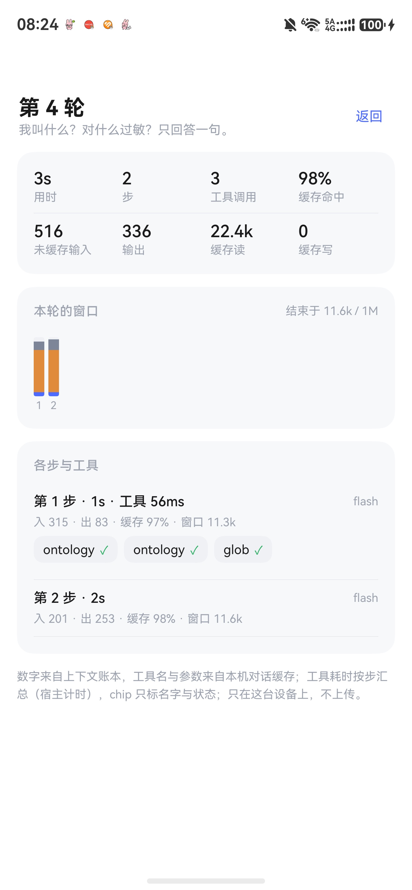

# 上下文账本（Context Ledger）与原生上下文面板

> 状态：**v2 + 每轮回执（2026-11-26）**：结算行之外新增「事件」与「步」两种行，面板从 4 张卡扩到 8 块
> （占用 + 阈值、统计条、趋势、组成、缓存、事件、耗时、每轮）；每轮行可点开**每轮回执**
> （逐步 token / 缓存 / 耗时 + 本机工具轨迹），回执**不新增任何账本行**。v1 的结算行格式**未变**，
> 旧文件照常读；新字段只在宿主管家能算出来时出现。
> 相关代码：`host/profile-ohos/.../@ohos/dsh-context-ledger/`、`entry/.../model/ContextLedger.ets`、
> `entry/.../view/ContextPanel.ets`、`entry/.../pages/Index.ets`（入口与覆盖层）。

## 它回答什么

输入框旁的上下文小环只回答「窗口有多满」。这个面板回答另外五个问题：

1. **窗口里是什么**——系统提示 / 工具 schema / 用户消息 / 注入上下文 / 助手回复 / 工具结果各占多少；
2. **它怎么长起来的**——每一步的占用柱状图，点哪根看哪步；有注入或压缩的那一步带点；
3. **为什么会变**——注入（时间上下文、长期记忆、指令文件…）、切换模型、压缩、裁剪工具结果，
   每条只记**生产者**和 token 增减，不记内容；
4. **前缀缓存有没有生效**——缓存读、未缓存输入、缓存写，以及命中率；
5. **时间花在哪 / 每轮各花了多少**——每步墙钟与工具耗时，每轮输入/输出/缓存/窗口。

## 为什么需要宿主插件

dsh 已经把这些数算好了：`@deepseek-ai/dsh-token-meter` 维护 `contextBreakdown`
（system/tools/messages）、`contextPressure`（used/window）两个会话投影，`assistant/message`
事件自带 provider 的 `usage`（input/output/cacheRead/cacheWrite/reasoning），会话日志里还有
注入、`model/selection`、`compaction/*` 与每个 `step/start`/`step/end` 的时间戳。

但 ACP 只转发 `usage_update`（used/size），**拿不到投影、拆分、事件和时间**。所以由
`@ohos/dsh-context-ledger` 在宿主侧订阅 `session/event`，把三种行追加到
`<dsh-home>/context-ledger.jsonl`，原生客户端读文件渲染。

没有 web 依赖、没有 UI 插件、没有模型工具 schema——对模型完全不可见。

## 三种行（同一个文件，按提交顺序）

### 1. 结算行（`v:1`，无 `k`）

一行一个 `assistant/message`。短键是为了控制手机上文件体积：

| 键 | 含义 |
|---|---|
| `v` | schema 版本，当前 `1` |
| `t` / `s` | 事件时间（ms）/ 会话 id |
| `turn` / `step` / `seq` | 轮次 / 步 / 会话事件序号 |
| `p` / `m` | provider / model |
| `ctx` / `win` | 上下文占用 / 窗口（`contextPressure`，缺失时回落到组成之和） |
| `sys` / `tools` / `msg` | 系统提示 / 工具 schema / 消息与工具结果的估算 token |
| `u` / `au` / `tr` / `ij` | **v2 新增**：消息桶的四拆分（用户 / 助手 / 工具结果 / 注入），四项之和 = `msg` |
| `thr` / `rsv` | **v2 新增**：自动压缩阈值 / 请求给回复预留的 token（拿不到就不写） |
| `inp` / `out` | 未缓存输入 / 输出 token |
| `cr` / `cw` | 缓存读 / 缓存写 token |
| `rs` | reasoning token |

### 2. 事件行（`v:2`，`k:"e"`）

| 键 | 含义 |
|---|---|
| `kind` | `inject` / `model` / `compact` / `prune` |
| `label` | 注入的生产者 kind（`time-context`、`ontology`…）/ 模型 id / 摘要模型 |
| `d` | 有符号 token 增减（压缩与裁剪为负） |
| `turn` / `step` / `seq` / `t` / `s` | 位置与时间 |

### 3. 步行（`v:2`，`k:"s"`）

| 键 | 含义 |
|---|---|
| `ms` | `step/start` → `step/end` 的墙钟 |
| `tool` | 该步内 `tool/call` → `tool/result` 的累计耗时 |
| `n` | 该步的工具调用数 |

## 数字是怎么来的（口径）

- **占用/窗口**：`contextPressure`（provider 回报，优先）→ 缺失时用组成之和。
- **三类组成**：`contextBreakdown`，token-meter 的固定密度估算。
- **四类消息拆分**：`ctx.tokenMeter.measure(session)` 给每个 **surface 节点**定价（含图片按路由
  计价的路径），插件按节点对应事件的类型归桶，再**按 `msg` 总量归一**——所以四个桶永远精确加到
  面板上的「消息与工具结果」总数，不会出现两处数字打架。拿不到 meter 时四个键不写，面板退回三类。
- **自动压缩阈值**：按 `dsh-compaction-basic` 的默认策略算
  `min(窗口 × 0.8, 窗口 − 预留输出 − 65536)`，预留输出取 `header.config.maxTokens`。
  `ohos` profile 不覆盖这两项，所以面板敢把阈值写成事实而不是建议：1M 窗、预留 250k 时是
  **727k（69%）**——比「80%」早得多，这正是旧面板「70% 该考虑压缩」蒙对、但说不出所以然的那条线。
- **缓存命中率** = `cr / (inp + cr + cw)`。
- **命中为什么会掉**：前缀缓存按**整段前缀**匹配。改工具集、改系统提示、换模型、更新应用
  构建，都会让改动处往后的内容全部重算。2026-11-26 实测：中途更新构建后 `ontology` 的工具描述
  从 2,899 涨到 3,088 字符（tools JSON 32,958 → 33,165），那一轮 `inp 5,836 / cr 4,608`
  = **44.1%**，与 tools JSON 里首个差异出现的位置（第 15,016 字符 ≈ 45.5%）几乎重合；同一构建
  内的后续步骤立刻回到 98%。所以面板每轮行会把「首步漏了多少」直接写出来
  （`缓存 44% · 首步 5.8k 未命中`），回执页再解释一次——一个孤零零的 44% 看起来像 bug，
  其实是一次性重建。

## 写入约束

- 监听器在回合事件派发里同步执行：**不 await、不抛错**；写盘走串行 promise 链。
- 队列上限 64 行，磁盘卡住时丢账本行而不是卡住回合；失败只告警一次。
- 文件超过 **4 MiB** 轮转到 `.1`（只保留一代）；客户端两代都读。
- **跳过 subagent 会话**：面板展示的是用户正在看的这条对话。
- 事件只记生产者 kind / 模型 id，**不记 prompt、不记工具参数、不记文件内容**。
- 读侧容忍撕裂的最后一行、空行、未知 `v`、`null`/数组等非对象 JSON、以及 v1 就有的旧文件。

## 入口与界面

上下文小环（`ChatView.contextRing`）点击 → `Index.openContext()` 读取账本（按 `s` 过滤当前会话）
→ 页面内渲染全屏覆盖层 `ContextPanel`。

> 覆盖层没有用 `bindContentCover`：该 Stack 已经承载文件预览 cover，父节点承载设置 sheet，
> 而同一节点只能挂一个这类模态（`Index.ets` 里已有同节点绑定破坏模态的注释）。

面板自上而下：

1. **占用卡**：`83.6k / 1.0M · 8%`，进度条上有一根**压缩阈值刻度**（默认 80%），副文案写清
   「到 839k 自动压缩 · 另有 64k 留给回复」；
2. **统计条**：轮 / 步 / 工具调用 / 时间跨度；
3. **趋势卡**：最近 24 步的堆叠柱（消息 / 工具 / 系统），压缩步红点、注入步蓝点、选中步蓝点；
   下方一行是选中步的 `第 N 轮 · 第 M 步 · 83.6k · 较上一步 +2.4k`；
4. **组成卡**：六色条 + 图例（系统 / 工具 / 用户 / 注入 / 助手 / 工具结果），每行带 % 与 token；
   旧宿主没有拆分时退回三类；
5. **缓存卡**：命中率、走了缓存的 token、未缓存输入、写入；命中率显示的是**稳态**
   （把「首步重算」的步骤剔除），下面一行写明 `另 N 次首步重算（X 未命中），不计入稳态`。
   剔除规则：单步 `inp ≥ 1000` 且命中 < 60%（`isRecompute`）；若整场只有重算步，则回退到原始命中率。
   同一会话实测：原始 92%（被一次构建更新拖低）→ 稳态 **98%**，卡上写「未计入：1 次首步重算 5.8k」，
   见 `images/screens/20-cache-steady.jpg`；
6. **事件卡**：最近 8 条注入/切换/压缩/裁剪，带生产者与 token 增减；
7. **耗时卡**：模型与等待 vs 工具执行（步墙钟减去工具时间）；
8. **每轮卡**：最近 12 轮，入/出/缓存命中/窗口。

空状态明确写出「只在使用 ACP 连接方式时记录」。

## 每轮回执（点一轮看它花在哪）

面板「最近 N 轮」每一行右侧有 `›`，点整行进入**每轮回执**（`TurnDetailPanel`）：

1. **汇总**：用时、步数、工具调用、缓存命中；未缓存输入 / 输出 / 缓存读 / 缓存写；
2. **本轮窗口**：每步一根三色柱（消息 / 工具 / 系统）+ 步号，标题写「结束于 12k / 1M」；
3. **各步与工具**：每步一行「第 k 步 · 1.2s · 工具 0.3s」+「入 / 出 / 缓存 % / 窗口」；
   工具是 chip（名字 · 耗时 · ✓/✕/…），点一下就地展开参数摘要与结果前几行；
4. **本轮发生**：只属于这一轮的注入 / 切模型 / 压缩 / 裁剪事件；
5. 返回键先回面板、再按一次才退出应用（`Index.onBackPress` 的三级栈）。



点开 `glob` 的 chip 就地展开参数与结果（`17-turn-receipt-tool.jpg`）；旧轮（v2 之前的账本）
没有逐步计时，回执显示整轮 token 并写明原因（`18-turn-receipt-old.jpg`）。

低缓存的轮次会被点名：面板行写 `缓存 44% · 首步 5.8k 未命中`，回执页解释一次为什么
（`19-cache-prefix.jpg`）——**一个孤零零的 44% 看起来像 bug，其实是一次性前缀重建**。

### 数据从哪来（两种来源，零新增账本行）

| 信息 | 来源 |
|---|---|
| 每步 token、缓存读写、窗口、组成 | 账本结算行 `v:1`（按 `turn` 过滤） |
| 每步墙钟、工具耗时、调用数 | 账本步行 `k:"s"` |
| 本轮事件 | 账本事件行 `k:"e"`（按 `turn` 过滤） |
| 工具名、参数摘要、结果摘要、状态、起止时间 | **本机** `ChatMessage.trace`（聊天里那枚「轨迹」chip 的同一份数据，随会话持久化） |

### 连接规则（全部在 `model/TurnDetail.ets`，纯函数、LocalUnit 可直测）

- 一步的时间窗 = `[步结束 − 步耗时, 步结束]`；工具按**开始时间**落进包含它的窗口
  （每个工具都在某一步内运行，所以不会跨轮）；
- 落在所有窗口之外的工具（时钟偏移、被中断的步）挂到**最近的一步**，并保留原状态；
- 只有计时没有结算的步（中断）照样列出来，token 显示 0；
- 一轮没有账本（v1 之前、或 SDK profile）→ 整页降级为「这一轮没有账本记录」；
- 有账本但本机没有轨迹（消息缓存被清）→ 步骤照常显示 token，工具区写「没有本机轨迹」。

### 边界

- 轨迹只在本机最近的消息缓存里（`SessionStore` 上限 200 条），**不随账本落盘**，也不上传；
- 回执页不显示价格（价目表要联网，v1 起就不做），也不涵盖子 agent；
- 展开工具显示的是聊天里已有的参数/结果摘要（已被 `MAX_TOOL_INPUT_CHARS` 截断），不是新的读取通道。

## 与 dsh-context 的取舍

社区插件 [`dsh-context`](https://github.com/bowenliang123/dsh-context) 是这套面板的主要参照。
我们**做了**它的：Current Context（组成）、Context Trend（趋势与 delta）、Context Events
（注入/压缩/切换，带生产者与 delta）、Timing Stats（模型/工具耗时）、Context Stats（轮/步/
工具数）、上下文阈值与压缩预留（它的 hatched 区）。**没做**：

- **Context Browser**（展开每个请求的每一段真实内容）——手机上体积与隐私代价都不合适，而且
  账本的原则是「只记计数与生产者」；
- **File Activity**（每个文件读/写/搜索的行数与行数增减）——属于工具轨迹，不是上下文账本；
- **Fleet**（父子 agent 网络）——ACP 不转发子 agent 的上下文；
- **跨会话 Insights 页 / 7 天用量图 / 成本估算**——成本要联网取 `models.dev` 价目表，与「本地、
  无额外出站」冲突（旧版就明确不做钱）；跨会话总览留给以后。

## 已知边界

- **只有 ACP profile 有账本**：SDK 兼容 profile 不挂 `ohos` bundle。
- **不回溯历史**：插件只记录安装之后的新回合；老会话的旧回合不在面板里。
- 组成数字来自 token-meter 的**启发式估算**（不是 tokenizer 精确值）；`ctx` 优先用 provider
  回报的占用。
- 阈值按 dsh 默认策略计算；若将来 profile 覆盖 `thresholdRatio` / `headroomTokens`，这里要跟着改。
- 面板不显示价格：价格需要联网取价目表（`models.dev`），与「本地、无额外出站」冲突。
- 事件里的注入 token 是**估算**（固定密度），只用于「这条大约多少」，不参与任何总量。

## 验收

本地：

```sh
cd host/profile-ohos/profiles/ohos/node_modules/@ohos/dsh-context-ledger && node --test test/*.test.mjs   # 12/12
bash scripts/test.sh unit local    # 插件 11 套 + LocalUnit 全绿
devecocli build                    # BUILD SUCCESSFUL
```

真机（2026-11-26 00:20–00:35，手机 CMM-AL10，ACP）：

1. 部署后跑一轮（`只回一句：收到`），设备上立刻出现三种行（`grep '"k":"e"'` 有两条）：

   ```json
   {"v":2,"k":"e","turn":5,"step":1,"kind":"inject","label":"ontology","d":76}
   {"v":2,"k":"e","turn":5,"step":1,"kind":"inject","label":"time-context","d":73}
   {"v":1,"turn":5,"step":1,"ctx":12010,"win":1048576,"sys":867,"tools":8296,"msg":2213,
    "u":70,"au":703,"tr":186,"ij":1254,"thr":727040,"rsv":256000,...}
   {"v":2,"k":"s","turn":5,"step":1,"ms":1274,"tool":0,"n":0}
   ```

   四类拆分之和 70 + 703 + 186 + 1254 = **2213 = `msg`**；阈值 727040 + 预留 256000 与
   `min(窗口×0.8, 窗口−预留−64k)` 完全一致。
2. 点小环 → 面板：`12k / 1M · 1%`，进度条上的红色刻度落在 69%，副文案
   「到 727k（69%）自动压缩；另有 256k 留给回复」；统计条 `5 轮 / 8 步 / 1 工具调用 / 2h2m`；
   趋势 8 根柱、选中 `第 5 轮 · 第 1 步 · 12k · +417`；六类组成
   `867 / 8.3k / 70 / 1.3k / 703 / 186`；缓存 92%；事件卡两条（长期记忆 +76、时间上下文 +73）。
   截图见 `docs/images/screens/03-context.jpg`（上）与 `15-context-activity.jpg`（下）。
3. **键盘不再盖住面板**：从已聚焦的输入框点小环，`openContext()` 先 `clearFocus()`，
   面板整屏可见（改前底部卡片被键盘挡掉一半）。
4. 三个只在真机暴露的坑：`user/message` 的载荷是**消息本身**（`data.source.kind`，不是
   `data.message.source`）——照 `assistant/message` 的形状读会把人说的话算进「注入上下文」、
   一条事件也不写；`ForEach` 键重复（两条注入同一毫秒）会静默吞掉一行；面板打开时输入框仍有焦点。

**每轮回执的真机取证（2026-11-26 08:10–08:35，同一台手机）**：

- 面板「最近 5 轮」每行右侧出现 `›`，标题右侧写着「点一轮看它花在哪」；点第 4 轮进回执：
  `3s / 2 步 / 3 工具调用 / 缓存 98%`，未缓存输入 516、输出 336、缓存读 22.4k、缓存写 0；
- 「本轮的窗口」两根柱（步 1、步 2），标题「结束于 11.6k / 1M」；
- 第 1 步 `1s · 工具 56ms`、`入 315 · 出 83 · 缓存 97% · 窗口 11.3k`，chip
  `ontology` / `ontology` / `glob` 全 ✓；点 `glob` 就地展开参数 `**/*` 与结果前四行，
  下方写明「在对话里展开可以看到完整结果」；
- 第 2 步 `2s`、`入 201 · 出 253 · 缓存 98% · 窗口 11.6k`（这一步没有工具）；
- 返回键先回面板、再按一次才退出应用；冷启后重进同一会话，回执仍在（账本 + 本地 trace 都持久化）。

三个只在回执里暴露的坑：

1. **没有逐步计时的旧轮不做工具归属**：首版把窗口左边界取 0，旧轮（账本 v2 前只有结算行）会把
   之前所有轮的工具都吞进这一轮。改成「没有 `k:"s"` 行就不归属」，界面写「这一轮没有逐步计时」。
2. **亚秒工具显示成 `0s`**（读起来像没跑）→ 回执改用 `56ms` 标签；
3. **chip 内联展开会把 chip 挤到下一行** → 展开块挪到 chip 行下方、整行宽；另外**本地 trace 的
   chip 耗时不可信**（同一 ACP 批次到达的 call/update 只差 1ms，而宿主计时是 56ms），所以 chip
   只显示名字与状态，耗时按步汇总。
